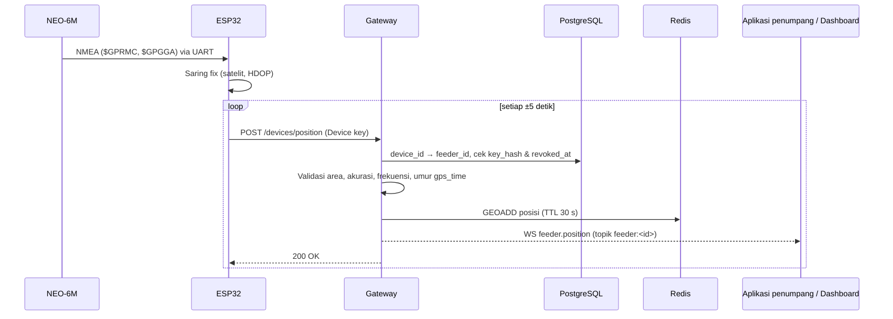

# Implementasi Sistem KONEKTA

KONEKTA adalah sistem *feeder* adaptif berbasis permintaan untuk angkutan
umum di Bandung. Permintaan penumpang dikumpulkan menjadi halte virtual,
kendaraan *feeder* ditugaskan untuk melayaninya, dan posisi setiap *feeder*
dipantau secara langsung (*live tracking*) oleh penumpang, sistem penugasan,
dan dashboard pemerintah.

Implementasi sistem melibatkan komponen perangkat keras dan perangkat lunak.
Di sisi perangkat keras, setiap kendaraan *feeder* dipasangi unit IoT pelacak
posisi berbasis mikrokontroler **ESP32** dan modul **GPS u-blox NEO-6M**. Di
sisi perangkat lunak, sistem terdiri atas server *backend* berbasis
*microservice*, basis data spasial, layanan *routing* jalan, aplikasi mobile
untuk penumpang dan pengemudi, serta dashboard web untuk pemerintah.

## 1. Perangkat Keras: Unit IoT Pelacak Feeder

Unit pemrosesan pada setiap *feeder* adalah ESP32 (Xtensa LX6 *dual-core*
hingga 240 MHz, SRAM 520 KB, Wi-Fi 802.11 b/g/n). ESP32 dipilih karena
konsumsi dayanya rendah, harganya murah, dan sudah memiliki Wi-Fi bawaan
sehingga dapat langsung mengirim data ke server melalui HTTPS. ESP32
dihubungkan ke modul GPS NEO-6M melalui antarmuka UART. Modul ini
mengeluarkan kalimat NMEA 0183 (`$GPRMC`, `$GPGGA`) yang berisi lintang,
bujur, kecepatan, arah gerak (*course over ground*), jumlah satelit, dan nilai
HDOP. Antena keramik (*patch antenna*) modul diletakkan di dekat kaca depan
atau dasbor kendaraan agar mendapat pandangan langit yang baik.

Tabel 1. Komponen unit IoT feeder

| Komponen | Fungsi |
|---|---|
| ESP32 DevKit | Membaca dan menyaring data GPS, mengirim posisi ke server |
| GPS u-blox NEO-6M + antena keramik | Menentukan posisi kendaraan (NMEA 0183 via UART, 9600 baud) |
| *Buck converter* 12 V → 5 V | Menurunkan tegangan aki kendaraan untuk catu daya unit |
| Router MiFi 4G di kendaraan | Menyediakan koneksi internet untuk Wi-Fi ESP32 |
| *Casing* tertutup | Melindungi rangkaian dari panas, debu, dan getaran |

Tabel 2. Rangkaian ESP32 – NEO-6M

| Pin NEO-6M | Pin ESP32 | Keterangan |
|---|---|---|
| VCC | 3V3 / 5V | Modul memiliki regulator internal |
| GND | GND | — |
| TX | GPIO16 (RX2) | Data NMEA dari GPS ke ESP32 |
| RX | GPIO17 (TX2) | Konfigurasi modul (opsional) |

Gambar 1. Rangkaian Perangkat IoT Feeder KONEKTA

*Firmware* ESP32 (Arduino/C++ dengan pustaka TinyGPS++) bekerja sebagai
berikut:

1. Membaca aliran NMEA dari NEO-6M secara terus-menerus melalui UART2.
2. Menyaring posisi: hanya *fix* yang valid dengan minimal empat satelit dan
   HDOP rendah yang dikirim, sehingga posisi yang melompat tidak muncul di
   peta.
3. Setiap ±5 detik, mengirim posisi terbaru ke *gateway* melalui HTTPS
   (`lat`, `lng`, `heading`, perkiraan akurasi, dan waktu GPS).
4. Saat koneksi terputus, hanya menyimpan posisi **terakhir**, bukan seluruh
   riwayat, lalu mengirimnya segera setelah tersambung kembali. Posisi lama
   tidak berguna untuk pelacakan langsung.

Setiap unit diprovisikan dengan identitas *feeder*-nya (misalnya `K1-03`)
dan kunci perangkat yang disimpan di memori NVS ESP32. *Gateway* memetakan
kunci tersebut ke *feeder* yang benar, sehingga sebuah unit tidak dapat
mengirim posisi atas nama *feeder* lain.

## 2. Perangkat Lunak

Perangkat lunak dibagi menjadi beberapa layanan yang dapat di-*deploy*
secara independen dan dijalankan dalam *container* Docker:

- **Gateway** (Python, FastAPI): pintu masuk REST dan WebSocket untuk
  seluruh aplikasi; menangani autentikasi, pemesanan (*booking*), dan
  penerimaan posisi *feeder*.
- **Pooling service**: mengelompokkan permintaan penumpang yang berdekatan
  dengan DBSCAN dan menghitung titik pusat berbobot sebagai kandidat halte
  virtual.
- **Stop-optimization service**: menilai kandidat halte virtual berdasarkan
  kepadatan permintaan, biaya penyimpangan rute, dan waktu sejak terakhir
  dilayani.
- **Forecasting service**: memprediksi permintaan dengan XGBoost untuk
  membantu penempatan awal *feeder*.
- **OSRM**: mesin *routing* untuk rute dan perkiraan waktu tempuh
  berdasarkan jaringan jalan Bandung. Datanya berasal dari ekstrak
  OpenStreetMap Pulau Jawa (Geofabrik) yang dipotong ke wilayah Bandung Raya.
- **PostgreSQL + PostGIS**: basis data utama, termasuk data spasial halte,
  koridor, *feeder*, dan pemesanan (`geography(Point, 4326)`).
- **Redis**: menyimpan sesi dan posisi terkini *feeder* menggunakan perintah
  GEO.
- **Aplikasi mobile** (Flutter): satu basis kode untuk peran penumpang dan
  pengemudi.
- **Dashboard web** (React + Vite): untuk peran pemerintah, menampilkan peta
  dan grafik pemantauan.

Data koridor dan *feeder* disimpan di tabel `corridors` dan `feeders`. Saat
ini sistem menggunakan dua koridor dengan lima *feeder* per koridor sebagai
data sementara (*placeholder*). Satu *feeder* hanya dapat terhubung ke satu
akun pengemudi: saat mendaftar, pengemudi memilih koridor dan nomor *feeder*
yang dikemudikannya pada formulir yang sama, dan *feeder* yang sudah dipakai
tidak ditampilkan.

Jika dijabarkan, struktur sistem KONEKTA meliputi:

1. Perangkat IoT (ESP32 + GPS NEO-6M) di setiap *feeder* yang membaca dan
   mengirim posisi kendaraan,
2. Jaringan seluler (MiFi 4G) dan Wi-Fi sebagai penghubung data ke internet,
3. Server *backend* (*gateway*, *microservice*, Redis, PostgreSQL/PostGIS,
   dan OSRM) yang memproses, menyimpan, dan menyebarkan data, dan
4. Aplikasi mobile (penumpang dan pengemudi) serta dashboard web
   (pemerintah) sebagai antarmuka pengguna.

Gambar 2. Rangkaian Sistem KONEKTA

## 3. Arsitektur Berlapis

Sistem KONEKTA menggunakan desain *multilayer architecture* yang tersusun
dalam empat lapisan:

1. **Perception layer**: ESP32 dengan GPS NEO-6M menangkap posisi *feeder*;
   ponsel penumpang menyediakan lokasi asal perjalanan.
2. **Network layer**: Wi-Fi ESP32 melalui MiFi 4G dan jaringan seluler
   ponsel mengirim data ke internet dengan HTTPS (posisi, pemesanan) dan
   WebSocket (pembaruan *real-time*).
3. **Middleware layer**: *gateway* FastAPI memvalidasi dan menyebarkan
   data; Redis menyimpan posisi terkini; PostgreSQL/PostGIS menyimpan data
   permanen; layanan *pooling*, optimasi halte, prediksi permintaan, dan OSRM
   mengolah data menjadi keputusan penugasan.
4. **Application layer**: aplikasi mobile menampilkan posisi *feeder*, status
   perjalanan, dan halte jemput; dashboard web menampilkan informasi armada
   dan permintaan untuk pemerintah.

Gambar 3. Architecture Layer KONEKTA

### Alur data live tracking

1. ESP32 mengirim posisi *feeder* ke *gateway* sekitar setiap 5 detik.
2. *Gateway* memvalidasi posisi: harus berada di area layanan Bandung Raya
   (lintang −7,05 s.d. −6,80; bujur 107,50 s.d. 107,75), akurasinya tidak
   lebih buruk dari 100 m, dan tidak dikirim lebih sering dari sekali per
   detik.
3. Posisi yang valid disimpan di Redis (`GEOADD`) dengan masa berlaku 30
   detik. *Feeder* yang tidak mengirim posisi selama 30 detik otomatis
   dianggap *offline* dan tidak lagi muncul dalam pencarian.
4. *Gateway* menyebarkan posisi sebagai pesan `feeder.position` melalui
   WebSocket ke klien yang berlangganan topik `feeder:<id>`. Penumpang hanya
   berlangganan *feeder* yang ditugaskan kepadanya.
5. Layanan pemesanan memakai data yang sama untuk mencari *feeder* terdekat
   saat pencocokan (radius 3 km) dan menandai status "*feeder* mendekat"
   ketika *feeder* berada dalam radius 300 m dari halte jemput.

Sesuai prinsip perlindungan data pribadi (UU PDP), riwayat posisi *feeder*
belum disimpan secara permanen. Hanya posisi terkini yang disimpan, dengan
masa berlaku singkat.

Gambar 4. Alur Data Live Tracking Feeder

## 4. Integrasi Unit IoT dengan Backend

Saat ini sumber posisi *feeder* yang sudah diimplementasikan adalah ponsel
pengemudi: aplikasi mobile mengirim posisi ke `POST /feeders/me/position`
menggunakan sesi login pengemudi, lalu *gateway* memetakan pengemudi ke
*feeder*-nya. Unit IoT direncanakan memakai jalur pemrosesan yang **sama**
(validasi → Redis → WebSocket), tetapi dengan *endpoint* dan autentikasi
perangkat sendiri karena ESP32 tidak login sebagai pengguna.

### 4.1 Provisioning perangkat

1. Admin mendaftarkan unit melalui CLI *gateway* dan menautkannya ke satu
   *feeder* (misalnya `K1-03`). *Gateway* membuat `device_id` dan kunci
   perangkat acak.
2. Yang disimpan di basis data hanya *hash* kunci, pada tabel `feeder_devices`
   (`device_id`, `feeder_id`, `key_hash`, `revoked_at`). Satu *feeder* hanya
   memiliki satu perangkat aktif.
3. `device_id` dan kunci ditulis ke NVS ESP32 saat *flashing*. Jika unit
   hilang atau dipindah ke kendaraan lain, admin mencabut (`revoked_at`) dan
   memprovisikan ulang.

### 4.2 Alur pengiriman posisi

1. ESP32 membaca NMEA dari NEO-6M dan menyaring *fix* (≥ 4 satelit, HDOP
   rendah).
2. ESP32 mengirim `POST /devices/position` melalui HTTPS dengan header
   `Authorization: Device <device_id>:<kunci>` dan isi
   `{lat, lng, heading, accuracy_m, gps_time}`. NEO-6M tidak memberikan
   akurasi dalam meter, sehingga `accuracy_m` diperkirakan dari
   HDOP × ±5 m.
3. *Gateway* mencocokkan kunci dengan `key_hash`, menolak perangkat yang
   dicabut (401), lalu mendapatkan `feeder_id` dari tabel `feeder_devices`.
   Perangkat tidak pernah mengirim `feeder_id` sendiri.
4. *Gateway* menjalankan validasi yang sama dengan jalur ponsel (area layanan,
   akurasi ≤ 100 m, maksimal sekali per detik per *feeder*). Selain itu,
   posisi dengan `gps_time` lebih lama dari 30 detik ditolak, sehingga posisi
   terakhir yang dikirim ulang setelah koneksi pulih tidak ditampilkan sebagai
   posisi terkini.
5. Posisi valid disimpan ke Redis (`GEOADD`, TTL 30 detik) dan disebarkan
   sebagai `feeder.position` ke topik `feeder:<id>`, persis seperti alur
   pada Bagian 3.

Gambar 5. Alur Integrasi Unit IoT dengan Backend

### 4.3 Hubungan dengan aplikasi pengemudi

Unit IoT menjadi sumber posisi utama, sedangkan aplikasi pengemudi tetap
menentukan **status dinas** (*on duty* / *offline*):

- Posisi dari perangkat hanya disimpan dan disebarkan ketika pengemudi
  sedang *on duty*. Di luar jam dinas, laporan perangkat diabaikan, sehingga
  kendaraan tidak dilacak tanpa keperluan layanan (prinsip UU PDP).
- Tombol *offline* di aplikasi pengemudi tetap menghapus posisi *feeder* dari
  Redis (`POST /feeders/me/offline`).
- Jika perangkat tidak mengirim posisi selama lebih dari 10 detik (rusak,
  tidak ada sinyal GPS), posisi dari ponsel pengemudi dipakai sebagai
  cadangan. Setiap posisi diberi penanda `source` (`device` atau `phone`)
  agar sumbernya dapat dipantau dari dashboard.

### 4.4 Penanganan kegagalan di perangkat

Tabel 3. Respons gateway dan tindakan firmware

| Kondisi | Respons gateway | Tindakan ESP32 |
|---|---|---|
| Posisi diterima | 200 | Lanjut ke siklus berikutnya |
| Kunci salah atau perangkat dicabut | 401 | Berhenti mengirim, nyalakan LED status error |
| Di luar area layanan atau akurasi buruk | 422 | Buang posisi, tunggu *fix* berikutnya |
| Terlalu sering | 429 | Perpanjang interval pengiriman |
| Tidak ada koneksi atau *timeout* | — | Simpan posisi terakhir saja, kirim ulang saat tersambung |
| Belum ada *fix* GPS | — | Tidak mengirim apa pun |

## 5. Pengujian

Pengujian awal bertujuan memverifikasi fungsionalitas perangkat lunak
*backend* dan aplikasi mobile menggunakan data posisi simulasi. Beberapa
temuan penting dari pengujian fungsional dan integrasi:

- **Gateway**: seluruh 188 pengujian otomatis (pytest) lulus, dijalankan
  terhadap PostgreSQL/PostGIS dan Redis sungguhan. Pengujian mencakup
  validasi area layanan, akurasi, dan pembatasan frekuensi; urutan jarak
  serta penyaringan koridor pada pencarian *feeder* terdekat; kedaluwarsa
  posisi *feeder* yang *offline*; transaksi pendaftaran pengemudi beserta
  *feeder*-nya; format pesan `feeder.position` pada WebSocket; dan seluruh
  alur pemesanan yang sudah ada.
- **Aplikasi mobile**: seluruh 154 pengujian otomatis (`flutter test`)
  lulus. Pengujian mencakup penerimaan posisi *feeder* melalui WebSocket
  (termasuk pembuangan data yang terlambat atau rusak), alur izin lokasi,
  dan penanganan kesalahan pengiriman posisi.

Pengujian perangkat keras dan pengujian lapangan direncanakan pada tahap
berikutnya, yaitu:

- akurasi posisi NEO-6M dibandingkan titik acuan di beberapa ruas jalan
  Bandung, termasuk area dengan gedung tinggi;
- waktu memperoleh *fix* pertama (*time to first fix*) setelah kendaraan
  dinyalakan;
- latensi ujung-ke-ujung dari ESP32 hingga marker bergerak di aplikasi
  penumpang;
- perilaku sistem saat koneksi seluler terputus dan tersambung kembali; dan
- konsumsi daya unit IoT selama satu hari operasional.
